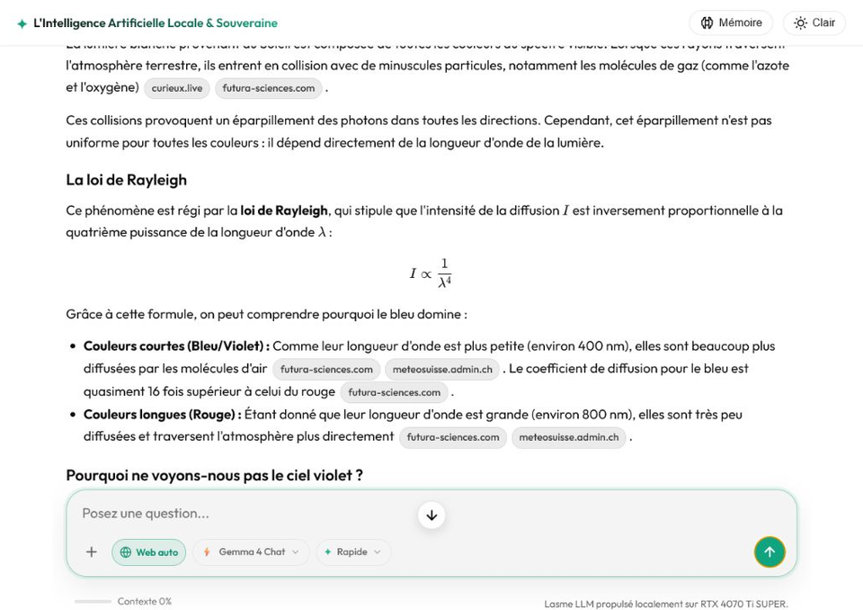
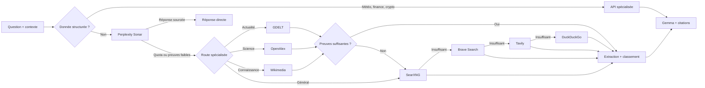

# Lasme LLM

Application locale de chat et d’assistance au développement basée sur Ollama.

<p align="center">
  
</p>

<p align="center">
  <em>Recherche Web, réponse en streaming, citations et rendu LaTeX — démonstration locale accélérée.</em>
</p>

<details>
  <summary>Afficher une capture statique</summary>
  <br>
  
</details>

## Architecture

```text
Navigateur
   │ HTTP + SSE
   ▼
FastAPI — http://127.0.0.1:8000
   ├── projets, conversations branchables et mémoire SQLite
   ├── RAG hybride persistant, isolé par projet
   ├── Canvas et artefacts versionnés
   ├── recherche approfondie avec plan et progression
   ├── recherche Web : recherche → extraction → vérification
   ├── données structurées : météo, actions et crypto
   ├── génération d’images externe facultative
   └── espace de développement local sécurisé
             │
             ▼
Ollama — http://127.0.0.1:11434
   ├── gemma-4-chat:latest — Q4_0
   └── gemma-4-fable:latest — Q6_K
```

Cloudflared est uniquement un tunnel HTTPS vers FastAPI. Ce n’est pas un
serveur d’inférence supplémentaire.

## Modèles

| Nom affiché | Identifiant Ollama | Usage | Contexte applicatif |
| --- | --- | --- | --- |
| Gemma 4 Chat | `gemma-4-chat` | Conversation générale | 65 536 tokens |
| Gemma 4 Fable | `gemma-4-fable` | Raisonnement, code et tâches agentiques | 65 536 tokens |

Les fichiers GGUF ne sont pas conservés dans ce dépôt. Ollama gère son propre
stockage. L’application n’installe ni ne télécharge automatiquement de modèle.

L’analyse d’images est désactivée tant que `VISION_MODEL` ne référence pas un
modèle Ollama compatible. Cette désactivation évite de réintroduire implicitement
un ancien modèle Qwen.

## Installation

```powershell
python -m venv .venv
.\.venv\Scripts\Activate.ps1
python -m pip install -r requirements.txt
Copy-Item .env.example .env
python -m uvicorn chat.server.main:app --host 127.0.0.1 --port 8000
```

Ouvrir ensuite <http://127.0.0.1:8000/>.

## Espaces de travail, conversations et Canvas

Les conversations peuvent être regroupées dans des projets. Chaque projet
possède ses propres instructions, son modèle par défaut, ses documents et sa
politique de mémoire. Le projet `Général` conserve la mémoire personnelle
globale ; un nouveau projet utilise par défaut une mémoire isolée.

Les actions affichées sous les messages permettent de copier, créer une
branche, modifier un ancien message puis régénérer depuis ce point, ou ouvrir
une réponse dans Canvas. Ces opérations ne modifient jamais la conversation
originale.

Canvas offre une vue édition/aperçu pour les documents, Markdown, code,
tableaux et rapports de recherche. Chaque sauvegarde crée une version
immuable, consultable et exportable.

## Recherche Web et recherche approfondie

Le bouton Web possède quatre états :

- `Web auto` : recherche seulement pour les informations actuelles, les
  demandes explicites de vérification et les relances qui nécessitent une mise
  à jour ;
- `Web` : recherche forcée, sauf pour une salutation triviale ;
- `Recherche` : affiche un plan, recoupe plusieurs axes de recherche puis
  produit un rapport cité automatiquement conservé dans Canvas ;
- `Web off` : aucune requête externe.

L’orchestrateur ne demande plus systématiquement le même nombre de sources.
Perplexity Sonar reste prioritaire lorsqu’il peut produire une réponse
directement sourcée. À défaut, une route spécialisée peut interroger GDELT
pour l’actualité, OpenAlex pour les publications scientifiques ou Wikimedia
pour les faits encyclopédiques. La recherche généraliste complète ensuite les
preuves avec SearXNG, Brave Search, Tavily et enfin DuckDuckGo. Chaque étape
s’arrête dès que les résultats sont suffisamment pertinents, indépendants et
fiables ; les erreurs d’authentification, de quota et de disponibilité
déclenchent une bascule transparente.



Quand Sonar fournit une réponse sourcée, l’application conserve directement
son texte et l’ordre exact de ses citations : Gemma ne la paraphrase plus. Le
fil récent de la conversation est transmis pour comprendre correctement les
relances, mais les anciennes réponses ne sont jamais considérées comme des
faits fiables. Pour les autres fournisseurs, l’orchestrateur classe les
candidats, extrait le contenu principal des meilleures pages avec Trafilatura
dans un délai borné, puis confie ces preuves à Gemma. Le nombre de sources varie
donc selon la difficulté et la qualité des résultats.

Configurer `PERPLEXITY_API_KEY` pour Sonar, `BRAVE_SEARCH_API_KEY` pour Brave
et `TAVILY_API_KEY` pour Tavily. `PERPLEXITY_SONAR_MODEL` permet de changer le
modèle Sonar ; la valeur par défaut est `sonar`. GDELT et Wikimedia ne
nécessitent aucune clé. OpenAlex demande une clé gratuite facultative dans
`OPENALEX_API_KEY`. Les routes spécialisées peuvent être désactivées avec
`SEARCH_SPECIALISTS_ENABLED=false`.

SearXNG est facultatif et désactivé par défaut. Après installation de Docker :

```powershell
$env:SEARXNG_SECRET = "une-valeur-locale-longue-et-aleatoire"
docker compose -f infra/searxng/compose.yaml up -d
```

Définir ensuite `SEARXNG_ENABLED=true` dans `.env` puis redémarrer le backend.
Le service n’écoute que sur `127.0.0.1:8080`. SearXNG reste un composant externe
AGPL-3.0 appelé par HTTP ; aucun de ses fichiers source n’est inclus ici.

Les demandes de météo, de cours boursiers et de crypto-actifs peuvent aussi
utiliser des API structurées avant la recherche Web générale. Les URL locales,
privées et réservées restent bloquées.

## Mémoire et continuité

Deux niveaux complémentaires évitent de renvoyer tout l’historique au modèle :

- une compaction progressive propre à chaque conversation conserve les
  décisions, corrections, contraintes et tâches en cours ;
- une mémoire personnelle inter-conversations retient uniquement des
  préférences durables.

La mémoire personnelle est consultable depuis l’en-tête. Chaque élément peut
être corrigé, désactivé ou supprimé, et l’enregistrement automatique peut être
coupé entièrement. Les anciens extraits Web et documents ne sont jamais
recopiés tels quels dans les résumés.

## Raisonnement

L’interface expose quatre niveaux :

- Rapide : pas de thinking, sortie limitée ;
- Équilibré : reasoning `medium` lorsqu’il est utile ;
- Approfondi : reasoning `high` ;
- Maximum : reasoning `max` et budget de sortie maximal.

Le raisonnement interne fourni séparément par Ollama n’est ni affiché ni stocké
dans la mémoire. Seule la réponse finale est conservée.

## Performances et streaming

Le chemin de génération est conçu pour réduire à la fois la latence réelle et
la latence perçue :

- le client HTTP vers Ollama est persistant et réutilise ses connexions ;
- l’historique est limité aux messages récents et pertinents, complétés par une
  mémoire compacte ;
- le mode Rapide désactive le raisonnement et les autres niveaux n’augmentent
  le budget de calcul que lorsque cela est demandé ;
- `Web auto` évite une recherche externe pour les questions stables, tout en
  conservant la recherche pour les relances liées à un sujet actuel ;
- les tâches secondaires comme le titre et la mémoire sont exécutées sans
  bloquer le flux principal ;
- les événements SSE sont affichés progressivement dès leur réception ;
- le rendu Markdown est regroupé par trames pour éviter un recalcul coûteux à
  chaque token ;
- chaque conversation possède son propre contrôleur de génération : changer de
  conversation n’interrompt plus automatiquement le flux précédent ;
- l’interface affiche l’occupation du contexte et propose trois relances
  facultatives après une réponse.

Sur la configuration de référence — RTX 4070 Ti SUPER 16 Go — le débit observé
se situe généralement autour de 45 à 60 tokens par seconde. Ce chiffre dépend
du modèle, de la longueur du contexte, du niveau de raisonnement et de
l’utilisation de la recherche Web.

## Documents

Les fichiers PDF, TXT et Markdown sont limités à 10 Mo. Le texte extrait est
stocké dans SQLite au niveau du projet actif. Le découpage conserve la page et
la position de chaque extrait. Le classement hybride fusionne BM25 avec une
représentation vectorielle locale tolérante aux accents, flexions et petites
variations d’écriture. Les extraits injectés au modèle portent le nom du
document, la page et le numéro du fragment pour produire des citations
documentaires vérifiables.

## Accès distant avec Cloudflared

Les API provenant d’un proxy exigent `LASME_ACCESS_TOKEN`. Les routes
`/api/coding/*` restent interdites à distance par défaut.

1. Définir un long jeton aléatoire dans `.env`.
2. Redémarrer FastAPI.
3. Lancer le tunnel vers `http://127.0.0.1:8000`.
4. Sur le téléphone, ouvrir une seule fois :

```text
https://adresse-du-tunnel.trycloudflare.com/?token=VOTRE_JETON
```

Le navigateur retire immédiatement le jeton de l’URL et le garde uniquement
pour la session courante.

Ne pas activer `LASME_ALLOW_REMOTE_CODING` sur un tunnel public. Voir
[docs/SECURITY.md](docs/SECURITY.md).

## Vie privée

Le chat et l’inférence sont locaux. Deux fonctions peuvent envoyer du contenu
hors de la machine :

- la recherche Web peut envoyer la requête à Perplexity, Brave, Tavily,
  SearXNG, DuckDuckGo, GDELT, OpenAlex ou Wikimedia selon le routage ;
- la génération d’images envoie le prompt à Pollinations.

La génération externe peut être coupée avec
`LASME_ENABLE_EXTERNAL_IMAGE_GENERATION=false`.

## Validation

```powershell
.\.venv\Scripts\python.exe -m unittest discover -s tests -v
.\.venv\Scripts\python.exe -m compileall -q chat core coding tests
node --check chat\web\app.js
node --check chat\web\workspace.js
.\.venv\Scripts\python.exe -m pip check
```

Un test comparatif manuel des deux modèles est disponible avec :

```powershell
.\.venv\Scripts\python.exe -m scripts.evaluate_models
```

Les dossiers `python_academy`, `pylearn`, `app` et `templates` sont des
prototypes séparés. Ils ne sont pas démarrés par l’application de chat.

## Licence

Ce projet original est distribué sous
[Apache License 2.0](LICENSE), une licence permissive qui inclut une concession
explicite de brevets. Les fonctionnalités de l’application ont été conçues et
implémentées indépendamment. Voir [NOTICE](NOTICE).
