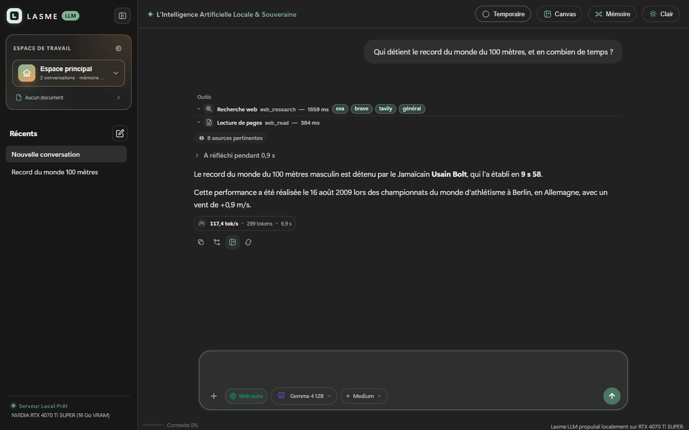

<div align="center">


# Lasme LLM

**Votre IA, sur votre machine. Elle raisonne, cherche, lit, calcule — et cite.**

Chat agentique **100 % local** : chaque message traverse une boucle
d'orchestrateur qui réfléchit, appelle ses outils, puis rédige une réponse
sourcée. Aucun compte, aucune clé obligatoire, aucune donnée qui sort de
votre disque.

[](https://github.com/lasme-ephrem/lasme-llm/actions/workflows/ci.yml)
[](LICENSE)
[](pyproject.toml)
[](#pourquoi-ce-projet)

<p align="center"></p>

</div>

---

## Pourquoi ce projet

Trois convictions, et ce qu'elles impliquent concrètement.

**1. Vos conversations ne regardent personne.** Le modèle tourne sur votre
GPU, les conversations vivent dans un fichier SQLite sur votre disque, les
documents indexés ne quittent pas la machine. La recherche web existe, mais
elle est **optionnelle, visible et désactivable** — et lorsqu'elle est
utilisée, vous voyez exactement quelles pages ont été lues. Aucun service
tiers n'est contacté pour le fonctionnement de base.

**2. Un chat qui ne cherche pas quand il faut est un chat qui invente.**
Ce projet part d'un constat simple : un modèle local se trompe sur tout ce
qui bouge — un prix, une version, un classement, un résultat de match. Le
harnais détecte donc ces sujets et **force la recherche** avant de répondre.
Il ne se contente pas de demander poliment : si le modèle affirme une valeur
absente des preuves, cette valeur est retirée de la réponse.

**3. L'interface ne doit jamais montrer un travail en cours comme s'il était
fini.** Rien n'est plus déroutant qu'une réponse qui s'écrit, disparaît, puis
réapparaît autrement. Ici, le brouillon est visible *comme brouillon*
(« ✎ Rédaction en cours »), puis rangé dans une note dépliable ; la réponse
finale est peinte d'un bloc, exactement telle qu'elle est enregistrée.

## Ce qui distingue cette plateforme

| | |
|---|---|
| **Le chat _est_ l'agent** | Pas de « mode agent » à activer. Chaque message passe par la boucle raisonnement → outils → réponse. |
| **Citations vérifiables** | Les marqueurs `[n]` deviennent des puces favicon au fil du texte ; une URL jamais consultée par l'agent est **retirée** de la réponse. |
| **Multi-chats parallèles** | Changez de conversation pendant une génération : elle continue en arrière-plan et se réaffiche intacte à la réouverture. |
| **Hors ligne par construction** | KaTeX, Mermaid, marked et DOMPurify sont servis localement. Le rendu mathématique fonctionne sans Internet. |
| **Le local ne veut pas dire lent** | Speculative decoding MTP, router multi-profils, jusqu'à **211 tok/s** mesurés sur une RTX 4070 Ti SUPER. |

## Fonctionnalités

### Le harnais d'agent

Le cœur du projet n'est pas le modèle, c'est la boucle qui l'encadre. Six
tours maximum, et des garanties couvertes par des tests :

- **Outils d'abord, réponse ensuite.** Un tour qui appelle un outil ne doit
  pas produire de réponse : son texte est classé comme note de travail, pas
  comme réponse. Sans cette règle, le modèle rédige un brouillon, appelle ses
  outils, puis réécrit tout — et l'utilisateur voit une réponse s'effacer.
- **Budget mesuré, pas deviné.** Le plafond de tokens suit l'effort demandé
  (Low 4 096, Medium 6 144, High le budget complet du profil). Une réponse
  tronquée est relancée une fois avec un budget doublé, plafonné à 12 288 ;
  le tour interrompu est *rangé*, jamais jeté en silence.
- **Anti-boucle.** Un appel d'outil strictement identique répété trois fois
  est refusé. Un modèle qui tourne en rond s'arrête au lieu de brûler le GPU.
- **Lire avant de citer.** Après un `web_research`, au moins une page doit
  être ouverte par `web_read`. Si le modèle répond depuis les extraits,
  l'orchestrateur récupère lui-même les URLs pertinentes ; répondre de mémoire
  alors que la demande exigeait une recherche est retoqué une fois.
- **Chiffres non étayés assagis, pas la réponse entière.** Sur un sujet
  sensible (prix, benchmark, disponibilité), une valeur absente des preuves
  devient « je n'ai pas de chiffre fiable là-dessus dans mes sources » —
  **phrase par phrase**. La mise en page (listes, tableaux) survit, et un
  numéro de version n'est jamais coupé en deux.
- **Relances traitées comme telles.** « Et par rapport à X ? » s'appuie sur
  les faits et les **sources déjà citées dans le fil** : la réponse n'est pas
  remplacée par un refus de vérification.
- **Voix humaine.** Le modèle ne récite pas son prompt, n'annonce pas ses
  règles, et pose une question de clarification concrète plutôt qu'un refus
  administratif.

### Effort de raisonnement

Sélecteur **Low / Medium / High** (défaut *Medium*), transmis tel quel au
modèle. Certains modèles refusent d'envoyer `reasoning.effort` et
`reasoning.max_tokens` ensemble : la requête tente l'un puis se replie
automatiquement sur l'autre.

### Recherche web

- MCP **Exa**, **Brave** et **Tavily** combinés, dédupliqués et classés
  (pertinence, autorité, fraîcheur). Sans clé, le moteur concerné ne démarre
  pas — la disponibilité réelle est affichée, jamais supposée.
- **Fraîcheur locale sans clé** : sport (TheSportsDB), météo (Open-Meteo),
  actualité tech (Hacker News), Wikipédia.
- Trois modes explicites : **off** (aucun outil web), **auto** (l'agent
  juge), **always** (recherche obligatoire). Les questions sensibles au temps
  déclenchent la recherche sans qu'on le demande.
- Les résultats sont **numérotés globalement** : dans un même message, une
  deuxième recherche continue la numérotation, donc `[3]` pointe toujours sur
  la bonne source.

### Interface

- **Brouillons conservés** : tout texte écarté par le harnais est rangé dans
  une note dépliable (« ✎ Brouillon non vérifié · 113 mots »), jamais supprimé.
- **Déroulé agent** : les appels d'outils d'une réponse passée se rejouent
  tour par tour, avec durées et sorties.
- **Réflexion séparée** : une ligne discrète, le texte au clic, sans cadre.
- **Édition en place** : corriger un message envoyé met à jour le fil et
  tronque la suite ; le bouton *Branche* crée une variante quand c'est ce
  qu'on veut.
- **Titres générés** par le modèle, en parallèle du premier flux.
- **Statistiques honnêtes** : tok/s mesurés sur le décodage réel du tour,
  hors temps d'outillage, avec TTFT et durée mur.
- **Maths complètes** : KaTeX avec `$…$`, `$$…$$`, `\(…\)`, `\[…\]`, matrices
  `pmatrix` incluses, et boucle de rendu jusqu'à stabilité.
- **Thèmes clair et sombre**, sans flash blanc au chargement.

<p align="center"></p>

### Mémoire, projets et documents

- Conversations persistées en SQLite avec compaction du contexte ; mémoire
  personnelle contrôlable et désactivable.
- Projets isolant instructions, fichiers, artefacts et mémoire.
- RAG sur documents (PDF, Office, Markdown, images) avec classement hybride
  lexical + vectoriel local, et citations fichier/page.

### Outils natifs

`calculate`, `current_time`, `python_run` (pool Docker chaud, sans réseau),
`analyze_image` (vision), recherche documentaire, fichiers projet, artefacts,
génération d'images (externe, **désactivée par défaut**). Les outils MCP
supplémentaires (Context7, GitHub, Git, SQLite, graphiques) suivent le profil
du modèle.

## Architecture

```
Navigateur — chat/web/  (aucun build : scripts classiques, découpés par domaine)
     │  SSE : reasoning_delta · content_delta · content_reset · content_replace ·
     │        agent_tool_call/result · research_plan/step · generation_stats
     ▼
FastAPI — chat/server/  (create_app + dépendances à résolution tardive)
     ├─► Orchestrateur agentique — core/agent/
     │     boucle THINK → outils → FINAL, budget, anti-boucle, garde-fous
     ├─► Runtime llama.cpp — core/inference/
     │     superviseur du llama-server en mode router (--models-preset),
     │     profils Gemma 4 QAT chargés à la demande, MTP, KV quantifié
     ├─► Outils plateforme — core/runner/ (Python Docker isolé), core/rag/,
     │     core/files/, core/artifacts/, core/memory/
     └─► Recherche — MCP Exa + Brave + Tavily, fraîcheur locale sans clé
```

Le serveur est un **monolithe modulaire** : une seule application FastAPI,
découpée en contrats (`chat/contracts/`), services
(`chat/server/services/`) et modules par domaine
(`chat/server/modules/<domaine>/`). Les modules ne s'importent pas entre eux ;
ils dépendent d'un conteneur de dépendances résolu à l'exécution. La matrice
d'imports est vérifiée en CI (`scripts/check_imports.py`) : `core/` ne dépend
jamais de `chat/`.

## Installation

**Prérequis**

- **Python ≥ 3.11**
- **llama.cpp compilé avec CUDA** — le superviseur cherche `llama-server.exe`
  dans `~/llama.cpp/build/bin/Release/` puis dans le `PATH`
  (`LLAMA_SERVER_PATH` pour forcer un chemin)
- **Node.js** (`npx`) et **uv** (`uvx`) — pour les serveurs MCP et la
  fraîcheur locale
- **Docker Desktop** *(optionnel)* — uniquement pour le bac à sable Python
- Clés API *(toutes optionnelles)* : Exa, Brave, Tavily, Context7, GitHub

**Mise en route**

```powershell
git clone https://github.com/lasme-ephrem/lasme-llm.git
cd lasme-llm
python -m venv .venv
.\.venv\Scripts\python.exe -m pip install -r requirements.txt
Copy-Item .env.example .env   # ne renseigner que ce que vous voulez activer
powershell.exe -NoProfile -ExecutionPolicy Bypass -File .\scripts\start_local.ps1
```

`start_local.ps1` démarre le router llama.cpp, construit l'image du bac à
sable si besoin, lance l'API et attend le contrôle de santé. Ouvrir ensuite
<http://127.0.0.1:8000/>.

Les profils Gemma 4 QAT (`unsloth/gemma-4-*-it-qat-GGUF`, drafter MTP et
projection vision inclus) sont téléchargés depuis Hugging Face au premier
usage. **Aucun modèle n'est préchargé** : sur 16 Go de VRAM, tout profil
résident fait échouer le placement du draft MTP — chaque profil charge donc
à la demande, ce qui ajoute quelques secondes à la première question.

**Démarrage manuel** (le superviseur est idempotent) :

```powershell
.\.venv\Scripts\python.exe -m scripts.serve start
.\.venv\Scripts\python.exe -m uvicorn chat.server.main:app --host 127.0.0.1 --port 8000
```

Arrêt : `python -m scripts.serve stop` et `.\scripts\stop_local.ps1`.
Pilotage : `status`, `metrics --model <profil>`, `info`.

## Configuration

`core/config.py` charge `.env` au démarrage. Le catalogue MCP lit ensuite les
clés dans l'environnement, **sans jamais les journaliser**.

```text
# --- Runtime llama.cpp (router) ---
LLAMA_SERVER_PATH=            # vide = découverte auto (~/llama.cpp puis PATH)
LLAMA_BASE_URL=http://127.0.0.1:8080
LLAMA_MODELS_MAX=2            # profils chargés simultanément
CHAT_MODEL=gemma-4-12b        # profils : gemma-4-12b / e4b / e2b / 12b-256k
FAST_MODEL=gemma-4-e4b
REASONING_MODEL=gemma-4-12b
CODING_MODEL=gemma-4-12b
VISION_MODEL=gemma-4-12b

# --- Recherche web (toutes optionnelles) ---
EXA_API_KEY=
BRAVE_SEARCH_API_KEY=
TAVILY_API_KEY=
CONTEXT7_API_KEY=
GITHUB_PERSONAL_ACCESS_TOKEN= # GITHUB_TOKEN accepté en secours
LASME_MCP_ENABLED=            # vide = activé ; 0/false/off/no coupe tout
LASME_MCP_DISABLED=           # ids à omettre, séparés par des virgules
LASME_MCP_FS_ROOT=            # racine du bac à sable fichiers
LASME_MCP_SQLITE_PATH=
LASME_MCP_GIT_REPO=

# --- Sécurité / accès distant ---
LASME_ACCESS_TOKEN=           # exigé dès que l'API passe par un proxy
LASME_ALLOW_REMOTE_CODING=false
LASME_ALLOW_DESTRUCTIVE_AGENT_TOOLS=false
LASME_ENABLE_AGENT_TERMINAL=false
LASME_WORKSPACE_ROOT=         # confinement des outils de fichiers
LASME_MAX_UPLOAD_BYTES=26214400
LASME_ENABLE_EXTERNAL_IMAGE_GENERATION=false  # Pollinations : opt-in explicite

# --- Bac à sable Python ---
LASME_RUNNER_POOL=            # 0 = conteneur froid par tâche
LASME_DOCKER_BINARY=

# --- Divers ---
LASME_DATABASE_PATH=          # base SQLite alternative (tests, instance isolée)
```

Autres variables reconnues : `LASME_ALLOWED_COMMANDS`, `LASME_PUBLIC_BASE_URL`,
`EXTRA_MODELS`, `HF_HOME`, `LLAMA_HOST` / `LLAMA_PORT`.

## Modèles et performances

Quatre profils Gemma 4 QAT servis par un seul llama-server en mode router,
présentés du plus léger au plus capable. Mesures sur **RTX 4070 Ti SUPER
16 Go** :

| Profil | Contexte | Rôle | Débit mesuré |
| --- | --- | --- | ---: |
| `gemma-4-e2b` | 32K | minimal | 214 tok/s |
| `gemma-4-e4b` | 64K | rapide | 129 tok/s |
| `gemma-4-12b` *(défaut)* | 128K | qualité, agent, vision native | 211 tok/s |
| `gemma-4-12b-256k` | 256K | très longs documents, KV q8_0 | 162 tok/s |

- **Speculative decoding MTP** (`draft-mtp`, n=4) sur tous les profils —
  ×3,4 sur le 12B par rapport à sans MTP.
- **KV cache quantifié** q8_0 sur le profil 256K ; le q4_0 est écarté
  (dégradation documentée du *tool calling*).
- Des budgets de non-régression sont versionnés dans
  `.models/logs/perf_baseline.json` et appliqués par `scripts/check_perf`
  (tolérance −10 %).

## Tests et validation

La CI locale et la CI GitHub exécutent **la même commande** :

```powershell
.\.venv\Scripts\python.exe -m scripts.validate_all          # 6 étapes
.\.venv\Scripts\python.exe -m scripts.validate_all --live   # + évals et budgets (router requis)
```

Elle enchaîne : compilation Python, syntaxe de **tous** les modules du front
(la liste est découverte, jamais écrite en dur — une liste figée survit à la
suppression d'un fichier et fait échouer la CI sur un vestige), tests
`node:test`, matrice d'imports entre couches, `pytest`, `pip check`.

Commandes ciblées :

```powershell
.\.venv\Scripts\python.exe -m pytest -p no:cacheprovider
node --test tests\js
.\.venv\Scripts\python.exe -m scripts.check_perf --model gemma-4-12b
.\.venv\Scripts\python.exe -m scripts.eval_agents --model gemma-4-e4b
```

**Deux garde-fous de contrat** méritent d'être connus, parce qu'ils
empêchent des régressions invisibles :

- `tests/snapshots/api_routes.json` + `tests/test_api_contract.py` figent la
  surface HTTP : ajouter, renommer ou retirer une route sans mettre le fichier
  à jour fait échouer la CI. Sans cela, un renommage de route casse
  silencieusement le front, qui construit ses URL par concaténation.
- `tests/js/module-load.test.cjs` concatène les scripts du front dans l'ordre
  de chargement et les évalue dans une portée unique avec un DOM factice : un
  doublon de déclaration, une variable utilisée avant sa définition ou un appel
  anticipé est attrapé **sans navigateur**.

## Sécurité

- **Clé API jamais journalisée ni versionnée** : `.env` est ignoré par Git,
  les journaux passent par une fonction de masquage.
- **Exécution Python durcie** : conteneur Docker sans réseau, racine en
  lecture seule, utilisateur non privilégié, limites mémoire / CPU /
  processus / durée, avec un pool chaud et un balayage des processus errants.
- **Entrées du modèle non fiables** : arguments d'outils validés contre un
  sous-ensemble JSON strict ; HTML du modèle nettoyé par DOMPurify ; Canvas
  dans une iframe `sandbox` sans accès à l'origine de l'application ; Mermaid
  en `securityLevel: strict`.
- **Désactivé par défaut** : terminal d'agent, outils destructifs, routes de
  codage à distance, génération d'images externe.
- **Accès distant** : toute API passant par un proxy exige
  `LASME_ACCESS_TOKEN` (comparaison à temps constant).

Détails et modèle de menaces : [`docs/SECURITY.md`](docs/SECURITY.md).

## Documentation

| Document | Contenu |
| --- | --- |
| [`docs/SECURITY.md`](docs/SECURITY.md) | Frontières de confiance, jeton distant, contenu non fiable, durcissement de l'exécution |
| [`docs/ADR-001-stockage-donnees.md`](docs/ADR-001-stockage-donnees.md) | Pourquoi une base SQLite unique avec un seul écrivain, et la règle du journal WAL |
| [`CONTRIBUTING.md`](CONTRIBUTING.md) | Règles de contribution, conventions, recette réelle |
| [`CHANGELOG.md`](CHANGELOG.md) | Historique détaillé des versions |
| [`NOTICE`](NOTICE) | Attributions des bibliothèques navigateur redistribuées |

## Dépannage

| Symptôme | Cause la plus fréquente |
| --- | --- |
| « llama-server introuvable » | `LLAMA_SERVER_PATH` vide et binaire absent de `~/llama.cpp/build/bin/Release/` |
| La première réponse met 30 s | Normal : aucun profil n'est préchargé, le modèle se charge à la demande |
| « Recherche Web non configurée » | Aucune clé Exa / Brave / Tavily dans `.env` |
| Le bac à sable Python ne répond pas | Docker Desktop arrêté, ou image `lasme-python-runner:latest` absente |
| Une réponse semble tronquée à l'écran | Recharger la page : le texte affiché est toujours celui enregistré en base |

## Licence

Distribué sous [**Apache License 2.0**](LICENSE). Voir [NOTICE](NOTICE) pour
les attributions des bibliothèques navigateur (DOMPurify, highlight.js, KaTeX,
marked, Mermaid), dont les textes de licence accompagnent chaque composant
sous `chat/web/vendor/`.
