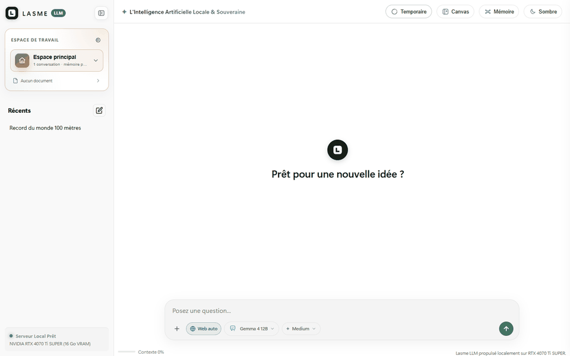
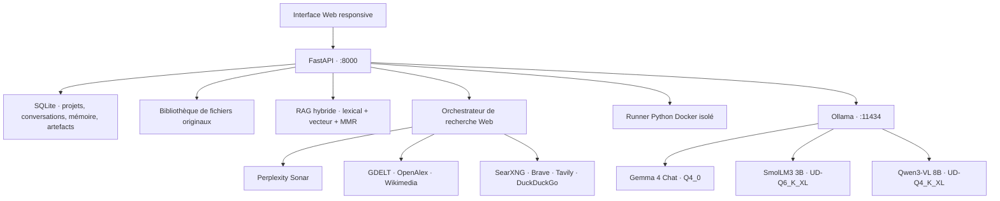
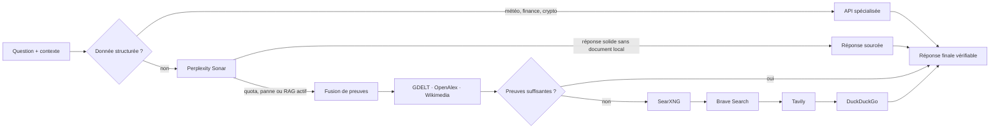

# Lasme LLM

Assistant IA local, multimodal et souverain, optimisé pour Ollama et une
RTX 4070 Ti SUPER 16 Go. Lasme LLM réunit conversations naturelles, recherche
Web sourcée, bibliothèque documentaire, RAG hybride, Canvas interactif,
exports bureautiques et exécution Python isolée.

<p align="center">
  
</p>

## Points forts

- **Chat local en streaming** : conversations branchables, édition d’un ancien
  message, régénération, réponses temporaires et métriques d’inférence.
- **Trois profils spécialisés** : Gemma 4 Chat pour la qualité générale,
  SmolLM3 pour la vitesse et Qwen3-VL pour les images, les documents visuels,
  le code et les tâches de raisonnement.
- **Recherche Web adaptative** : Sonar, moteurs spécialisés, SearXNG, Brave,
  Tavily et DuckDuckGo avec bascule selon la qualité, la disponibilité et les
  quotas.
- **RAG documentaire v2** : PDF, Word, Excel, PowerPoint, Markdown, texte et
  images, avec citations cliquables vers le fichier et la page.
- **Espaces de travail** : projets typés, favoris, couleurs, instructions,
  mémoire et fichiers isolés.
- **Canvas** : documents, code, tableaux, rapports, présentations, diagrammes
  Mermaid, cartes mentales et mini-applications HTML/CSS/JavaScript.
- **Exports réels** : DOCX, XLSX, PPTX, PDF, HTML, CSV, Markdown, texte et SVG.
- **Runner Python sécurisé** : calculs, graphiques et fichiers dans un
  conteneur Docker sans réseau, en lecture seule et avec des limites strictes.
- **Rendu local** : Markdown, LaTeX/KaTeX, coloration de code et Mermaid sont
  livrés avec l’application, sans CDN ni police distante.

## Architecture



Cloudflared, lorsqu’il est utilisé, est seulement un tunnel HTTPS vers FastAPI.
Il ne constitue pas un serveur d’inférence.

## Modèles

| Interface | Identifiant Ollama | Rôle | Contexte |
| --- | --- | --- | ---: |
| Gemma 4 Chat | `gemma-4-chat` | Modèle général par défaut, résident | 65 536 |
| Lasme Rapide | `lasme-smol-fast` | Réponses courtes et très rapides | 32 768 |
| Lasme Vision | `lasme-qwen-vision` | Images, tableaux, code, raisonnement | 16 384 |

Les deux modèles additionnels proviennent des dépôts GGUF officiels
[Unsloth SmolLM3-3B-GGUF](https://huggingface.co/unsloth/SmolLM3-3B-GGUF)
et
[Unsloth Qwen3-VL-8B-Instruct-GGUF](https://huggingface.co/unsloth/Qwen3-VL-8B-Instruct-GGUF).
Le script `scripts/install_fast_models.ps1` crée les alias Ollama propres sans
laisser de modèle temporaire visible. Aucun GGUF n’est versionné dans Git.

## Installation

Prérequis : Python, Ollama et, pour le runner Python et SearXNG, Docker
Desktop.

```powershell
git clone https://github.com/lasme-ephrem/lasme-llm.git
Set-Location lasme-llm
python -m venv .venv
.\.venv\Scripts\python.exe -m pip install -r requirements.txt
Copy-Item .env.example .env
powershell.exe -NoProfile -ExecutionPolicy Bypass -File .\scripts\install_fast_models.ps1
docker build -t lasme-python-runner:latest .\infra\runner
```

Renseigner uniquement les fournisseurs souhaités dans `.env`, puis démarrer
l’ensemble :

```powershell
powershell.exe -NoProfile -ExecutionPolicy Bypass -File .\scripts\start_local.ps1
```

Ouvrir <http://127.0.0.1:8000/>.

Pour arrêter FastAPI et SearXNG sans couper Ollama :

```powershell
powershell.exe -NoProfile -ExecutionPolicy Bypass -File .\scripts\stop_local.ps1
```

## Projets et bibliothèque de fichiers

L’**Espace principal** est toujours disponible et ne peut être ni renommé ni
supprimé. Les autres projets peuvent être classés comme général, recherche,
apprentissage, données, développement, rédaction ou média. Chaque projet
isole ses conversations, instructions, fichiers, artefacts et mode de mémoire.

La bibliothèque accepte jusqu’à 25 Mo par fichier :

| Format | Lecture et indexation |
| --- | --- |
| PDF | Texte avec mise en page, pages, Vision locale puis secours OCR |
| DOCX | Titres, paragraphes et tableaux |
| XLSX | Feuilles, cellules, valeurs et formules |
| PPTX | Diapositives, tableaux et notes |
| TXT / MD | Structure textuelle |
| PNG / JPG / WEBP | Qwen3-VL, puis secours OCR |

Les originaux sont conservés dans `.runtime/project_files`, dédupliqués par
empreinte SHA-256 et téléchargeables. L’extension, la signature binaire et la
structure interne des formats Office sont vérifiées avant stockage ; le type
MIME déclaré par le navigateur n’est jamais considéré comme fiable. Un PDF ou
une image peut être ouvert directement depuis la bibliothèque. Les citations
`[Document : fichier, p. X]` ouvrent la bonne ressource et la bonne page.

Les anciens index RAG dont l’original n’est plus disponible restent visibles
comme **index historiques** : ils peuvent encore être consultés ou supprimés,
mais doivent être réimportés pour retrouver le téléchargement. Un bouton
**Réindexer** permet aussi de relancer proprement l’analyse d’un original
conservé après une interruption.

Le classement RAG combine recherche lexicale, représentation vectorielle
locale, nom de fichier, section, correspondances exactes et diversification
MMR. Les relances utilisent le sujet récent de la conversation. Une recherche
approfondie peut fusionner les preuves des documents avec celles du Web.

## Canvas et artefacts

Canvas est un espace de travail à deux volets : source éditable à gauche et
aperçu à droite. Un artefact n’est pas une simple détection du contenu de la
réponse ; c’est un document durable, versionné et exportable.

| Modalité | Usage |
| --- | --- |
| Document mixte / Markdown | Cours, rapports, formules, code et tableaux |
| Code | Édition et exécution Python isolée |
| Tableau | Données structurées et export CSV/XLSX |
| Dossier de recherche | Rapport documenté avec résultats et sources |
| Présentation | Contenu structuré et export PPTX |
| Diagramme / carte mentale / graphique | Rendu Mermaid et export SVG |
| HTML / interactif | Mini-application autonome HTML/CSS/JavaScript |

Les aperçus HTML sont servis par une URL éphémère et affichés dans un iframe
sandboxé. Ils peuvent exécuter leur JavaScript, mais ne disposent ni du réseau,
ni des API de l’application, ni des formulaires, ni des permissions du
navigateur.

## Runner Python

Le bouton **Exécuter** de Canvas apparaît pour le code Python. Chaque tâche est
lancée dans l’image `lasme-python-runner:latest` avec :

- réseau désactivé ;
- système de fichiers racine en lecture seule ;
- capacités Linux supprimées et `no-new-privileges` ;
- utilisateur non privilégié dédié (UID 10001) ;
- mémoire, CPU, processus et durée limités ;
- dossier de sortie temporaire dédié ;
- au plus 32 fichiers, 20 Mo par fichier et 64 Mo au total ;
- suppression automatique des anciennes tâches.

Le résultat peut contenir la sortie standard, les erreurs, des graphiques PNG
et des fichiers CSV, JSON ou texte. Les routes du runner restent locales,
sauf activation explicite du codage distant — déconseillée sur un tunnel
public.

## Recherche Web

`Web auto` décide si une information actuelle ou une vérification est
nécessaire. `Web` force la recherche, `Recherche` lance une étude approfondie
et `Web off` garde la réponse entièrement locale.



Le nombre de sources est adaptatif. Les candidats sont dédupliqués et classés
selon pertinence, autorité, fraîcheur, contenu de preuve et diversité des
domaines. Les pages retenues sont extraites dans un délai borné et leur contenu
réel est vérifié une seconde fois. Si les extraits se révèlent insuffisants,
l’orchestrateur élargit automatiquement la chaîne de fournisseurs sans
facturer une seconde requête Sonar. Lorsqu’un
document local participe à la réponse, même une bonne réponse Sonar est
fusionnée avec les extraits RAG afin de conserver les deux familles de
citations et de signaler les divergences.

Variables principales :

```text
PERPLEXITY_API_KEY=
BRAVE_SEARCH_API_KEY=
SEARXNG_ENABLED=false
SEARXNG_BASE_URL=http://127.0.0.1:8080
TAVILY_API_KEY=
OPENALEX_API_KEY=
```

SearXNG est un service séparé sous AGPL-3.0, appelé par HTTP. Aucun de son code
source n’est inclus dans ce dépôt.

## Mémoire, continuité et qualité des réponses

Le contexte envoyé au modèle combine les tours récents, des messages anciens
réellement pertinents, un résumé progressif et, selon le projet, une mémoire
personnelle contrôlable. Les anciennes pages Web ou documents bruts ne sont
jamais recopiés aveuglément dans la mémoire.

La présentation s’adapte à l’intention : réponse directe, explication, cours,
tutoriel, comparaison, rapport, analyse de données ou artefact. Les cours
utilisent une introduction, une progression numérotée, des exemples puis une
conclusion. Les demandes factuelles récentes privilégient les preuves et
doivent exprimer l’incertitude plutôt qu’inventer.

Sous chaque réponse, Lasme affiche le débit de génération, le nombre de tokens,
la durée totale, le délai du premier token et la taille du contexte d’entrée.

Les migrations SQLite sont versionnées. Avant toute migration d’une base de
production existante, une sauvegarde cohérente est créée automatiquement dans
`.runtime/db_backups`.

## Accès distant

Toute API reçue via un proxy exige `LASME_ACCESS_TOKEN`. Après lancement de
Cloudflared, ouvrir une fois :

```text
https://votre-tunnel.trycloudflare.com/?token=VOTRE_JETON
```

Le jeton est retiré de l’URL puis conservé dans un cookie de session sécurisé.
Ne jamais activer `LASME_ALLOW_REMOTE_CODING` sur un tunnel public. Voir
[docs/SECURITY.md](docs/SECURITY.md).

## Vie privée

L’inférence, les conversations, les fichiers, le RAG, Canvas et le runner sont
locaux. Selon la configuration, une requête de recherche peut être envoyée à
un fournisseur Web. La génération d’images externe peut envoyer un prompt à
Pollinations et se désactive avec
`LASME_ENABLE_EXTERNAL_IMAGE_GENERATION=false`.

## Validation

```powershell
.\.venv\Scripts\python.exe -m pytest -q -p no:cacheprovider
.\.venv\Scripts\python.exe -m compileall -q chat core coding scripts tests
node --check chat\web\app.js
node --check chat\web\workspace.js
node --test tests\js\math-renderer.test.cjs
.\.venv\Scripts\python.exe -m pip check
.\.venv\Scripts\python.exe -m scripts.evaluate_models
```

Les ressources tierces livrées dans `chat/web/vendor` conservent leurs fichiers
de licence. Les prototypes historiques ignorés par Git ne font pas partie de
l’application de production.

## Licence

Lasme LLM est distribué sous [Apache License 2.0](LICENSE). Voir
[NOTICE](NOTICE) pour les attributions et la déclaration d’implémentation
indépendante.
